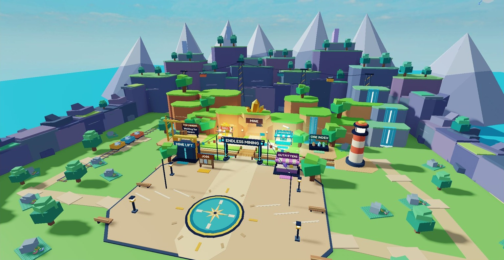
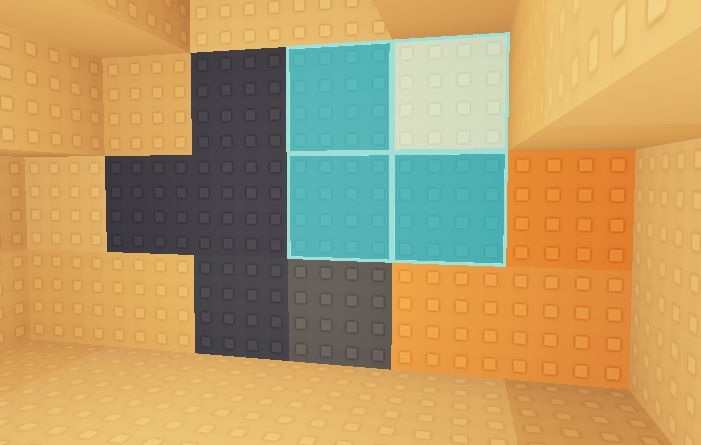

# Endless Mining



Citrine Cove is a multiplayer Roblox mining simulator. Aim at a cave wall or floor to highlight the exact blocks you can take, then hold to mine, sell your ore and upgrade. Each block face measures 4 × 4 studs. The starter tool takes one block per hit. The first Mining area upgrade costs 24 gold and takes two side by side. A starter pack holds 36 ore.

## Play locally

1. Open `EndlessMining.rbxlx` from this folder in Roblox Studio, or use the existing **Endless Mining** Studio place connected to this project's Rojo server.
2. Press **F5**. The island is already visible in edit mode. Play generates studded plastic bricks behind the cave mouth. Cross the bridge and walk beneath the golden crystal marked **MINE**. Aim at the dark starter seam and hold the left mouse button. On a touch device, aim with the center dot and hold **HOLD MINE**.
3. After eight blocks, open **Jobs** and claim **First strike** for 25 gold. Open **Gear → Mining area** and spend 24 gold to cut two blocks per hit. **Sell** cashes out the ore in your pack. Both the dock buttons and the harbor counters work.
4. At 36 lifetime blocks, open **Lift → Ember Foundry → Travel**. Use **↑ Harbor** to return from underground. Press **Shift+F5** to end the session.


To rebuild the local place after editing, run the following command in the project directory.

```powershell
rojo build default.project.json -o EndlessMining.rbxlx
```

For live editing, run `rojo serve default.project.json` here if this project's server is stopped. In Studio, use **Plugins → Rojo → Connect** and select **EndlessMining** at `localhost:34872`. A built place can be played directly without connecting the plugin.

## World and balance

The harbor spans roughly 268 × 229 studs inside a continuous rock rim. The spawn compass opens onto a 95-stud-wide court. Follow the central bridge to the mine, the amber bullion sign to Sell, or the cyan pickaxe to Upgrades. Side paths pass ore wagons, gardens and the stepped waterfall. Three overhead ore carriers shuttle between the ridge towers.

The location card's **Music on** button pauses and resumes the instrumental loop. The action dock, menu controls and touch mining button have local sound effects. The music is Jim Condelli's *Another 8 Bit Game* from APM's Roblox catalog. [Creator Store track](https://create.roblox.com/store/asset/9048374150/Another-8-Bit-Game)


The harbor has a lift tower, dispatch board, ore museum, pass stall and a board showing the three most productive miners in the current server. Each underground stop has a lit landing, return console and exposed ore seams. The lift unlocks with total blocks mined. The workshop's **Power** upgrade lets the pickaxe cut harder ores.

| Destination | Lifetime blocks | Depth | Featured seams |
| --- | ---: | ---: | --- |
| Citrine Harbor | 0 | Surface | Stone and coal in the starter mine |
| Ember Foundry | 36 | 80 studs | Iron and copper |
| Prism Arcade | 150 | 168 studs | Diamond and gold |
| Emerald Vault | 420 | 280 studs | Emerald and diamond |

The seven shift jobs award gold once each. The ore index records the seven ore types independently of your pack, so selling a find preserves its entry. Ranks, job claims and lift unlocks use lifetime mining progress.

The 192 × 224 stud mine extends 352 studs below the entrance. Sunstone Hollow gives way to the Iron Shelf, Prism Grotto, and Emerald Deep. Each 32-stud geological region receives a seeded, tilted ore deposit. Minimum and preferred depths control its composition. Some deep regions contain an oversized precious-metal or gem lode around a hollow pocket. A fixed coal seam makes the opening reproducible.

The server keeps one byte per grid cell. Only exposed rock needs physical Parts. Within each 8 × 8 × 8 cell chunk, neighbouring exposed cells of the same shade share anchored plastic bricks. Cutting a block rebuilds the affected chunks and exposes the next layer. Excavations are shared for the lifetime of that server.

Mining area upgrades unlock **1×1, 2×1, 2×2, 3×2, 3×3, 4×3, 4×4, and 5×5** face patterns. Each hit takes one layer. The turquoise outlines and on-screen count account for missing blocks, reach, obstructions, power and space in the pack. An almost-full pack selects the nearest blocks to the aim point first. The server checks the same pattern and intersects it with the squares the player saw. If another player takes one, the hit skips that square. Existing profiles retain their upgrade levels.



| Change | File |
| --- | --- |
| Seed, site, layers, reach, save interval and work budget | `src/shared/GameConfig.luau` |
| Ore appearance, value, hardness and depth weighting | `src/shared/Ores.luau` |
| Upgrade values, level caps and cost curves | `src/shared/Upgrades.luau` |
| Jobs, ranks and lift destinations | `src/shared/Expeditions.luau` |
| Game pass IDs and perks | `src/shared/PassCatalog.luau`, `src/server/Passes.luau` |
| Vein shapes, rich pockets and the starter seam | `src/server/Geology.luau` |
| Editable island, signed stations, spawn and bridge | `map/CitrineCove.rbxmx` |
| Studded brick geometry and face patterns | `src/server/MineBlocks.luau`, `src/shared/BlockPattern.luau` |
| Station binding | `src/server/Quarry.luau` |
| Starting editor camera and lighting | `default.project.json` |
| Music and button sounds | `src/client/HarborAudio.luau` |

## Project and data ownership

Rojo owns the scripts under `ReplicatedStorage.Shared`, `ServerScriptService.Server` and `StarterPlayer.StarterPlayerScripts.Client`, plus the authored `Workspace.CitrineCove` model and the lighting listed in `default.project.json`. To keep island edits in the source project, export the selected CitrineCove model from Studio as `map/CitrineCove.rbxmx` before rebuilding. Keep additional Studio-only models as siblings in Workspace. The server starts the mine at the island’s SiteOrigin and checks for unrelated parts and existing terrain before choosing a dig site. If the site is occupied, it relocates the island and mine together for that session. Existing terrain palettes are preserved.

During Play the edit-mode cave face gives way to the shared block grid. Remotes, HUD and headlamps are created at runtime. Player profiles contain gold, ore still in the pack, upgrade levels, lifetime ore mined, best depth, completed jobs and discovered ore types. The server uses DataStore `EndlessMining_v1` with separate Studio and live scopes, conditional session ownership, periodic saves, and leave/shutdown saves. A failed load or unsupported record opens an explicitly labeled temporary session with writes disabled. An unpublished local build or a simulated test user gets a practice session.

## Visual references

Three local Roblox captures in `%LOCALAPPDATA%\Roblox\tmp-capture-storage` informed the island. The beach scene ending in `1795063278721` supplied the sea, sand-path and studded-lawn palette. The grass ledges in `1795062944957` informed the layered bluffs. The striped tool stand in `1795063226069` informed the small coral and teal market stalls. The citrine outcrop and island geometry use native Studio parts.

The two newer lobby captures ending in `1795070093346` and `1795070096049` informed the oversized signs, colored icon dock and visible job tracker. The harbor, pickaxe and HUD icons are built from native Roblox objects.

## Outfitters and Robux

**Double Gold** doubles ore-sale proceeds. **Prism Trail** equips a cosmetic rainbow trail that returns after respawn. **Store → Try in Studio** previews either perk in an unpublished practice session. A trial ends when the player leaves.

To turn on real sales after publishing, create two passes for this experience under **Creator Dashboard → Monetization → Passes**, put them on sale, and enter their pass asset IDs in `src/shared/PassCatalog.luau`. Publish the updated build. The shop requests the player's current price from Roblox, and checkout opens after the player selects the price. The server checks ownership on join and grants successful purchases. [Roblox pass setup](https://create.roblox.com/docs/production/monetization/passes) · [Regional pricing](https://create.roblox.com/docs/production/monetization/regional-pricing)

## Reproduce the checks

The two test scripts live outside the Rojo tree. Use a fresh local build. Studio's **RunScript** command runs the checks in a disposable session. With Studio open, these PowerShell commands select its installed executable.

```powershell
$studioExe = (Get-Process RobloxStudioBeta | Select-Object -First 1).Path
$quarryPlace = (Resolve-Path '.\EndlessMining.rbxlx').Path
$terrainTest = (Resolve-Path '.\tests\Quarry.spec.luau').Path
$playTest = (Resolve-Path '.\tests\Play.spec.luau').Path

& $studioExe --task RunScript --localPlaceFile $quarryPlace --runScriptFile $terrainTest --outputFile "$env:TEMP\EndlessMining-terrain.log" --quitAfterExecution
```

Look for a standalone `QUARRY_TESTS_PASSED` output line. The map checks cover the walk from spawn, both market counters, their lights, the outer paths and 360 directions around the rock rim. The mining checks cover save ownership, profile validation, economy, three seeds, shared depletion, server reach and obstructions, face previews on all six sides, stale selections and repeated 5×5 cuts. Then run the two-client check in a signed-in Studio session.

```powershell
& $studioExe --task RunScript --localPlaceFile $quarryPlace --runScriptFile $playTest --outputFile "$env:TEMP\EndlessMining-play.log" --quitAfterExecution
```

The two-client check uses real client-to-server requests. Each miner must open all five menus, fill a pack, sell it, upgrade to a two-block cut, claim a job once, try both Studio passes, travel to the Foundry, and return to the surface. The test also checks that the Vault stays locked, each sound loads, the music pauses and resumes, and an ore carrier moves. Look for `QUARRY_PLAYTEST_RESULT PASS` followed by both clients' results.

For hands-on checks, choose **Server & Clients** in Studio's Test selector and start two players. Mine the same face, compare balances and verify both players see the same missing bricks. Use the device emulator to check the shop, hold/release control, thumbstick and jump in phone landscape and portrait. A persistence round trip requires a separate published test place with Studio API access enabled. Sell ore, buy an upgrade, stop the session and rejoin to verify the balance and level.
