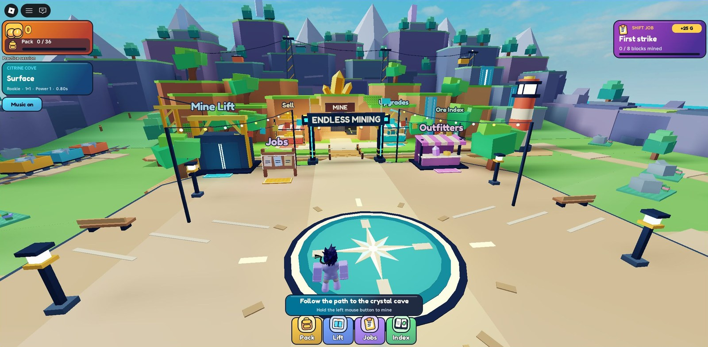
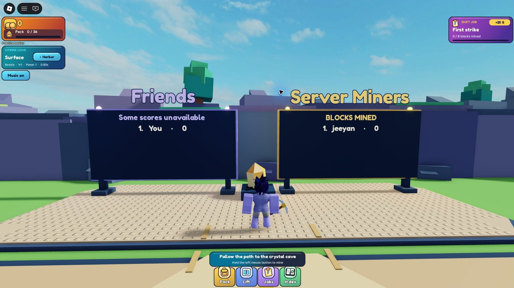

# Endless Mining


Citrine Cove is a multiplayer Roblox mining simulator. Aim at a cave wall or floor to highlight a single block, hold through the pickaxe swing, and bring the ore to the harbor. Each block face measures 4 × 4 studs. Every pick takes one block per cut. Speed shortens the cut and Power unlocks harder ore. A starter pack holds 36 ore.

## Play locally

1. Open `build/EndlessMining.rbxlx` in Roblox Studio, or use the existing **Endless Mining** Studio place connected to this project's Rojo server. To create the build from a fresh checkout, use the commands below.
2. Press **F5**. The island is already visible in edit mode. Play generates studded plastic bricks behind the cave mouth. Cross the bridge and walk beneath the golden crystal marked **MINE**. Aim at an exposed studded block and hold the left mouse button. On a touch device, aim with the center dot and hold **HOLD MINE**.
3. After eight blocks, open **Jobs** and claim **First strike** for 25 gold. Walk to the cyan **Upgrades** stall, use its prompt and buy **Capacity** for 24 gold to carry 80 blocks. Use the amber **Sell** counter to empty your pack. The side panel lists carried materials, rarest first, along with quantities and sale value. Select it to inspect the full pack.
4. Dig through the walls and floor to reach deeper regions. The location card shows your X, Y and Z in blocks from the mine entrance. Y drops by one for each full block you descend. At Y −27 you enter Iron Shelf. **Index** lists the per-block ore chances at each depth. **↑ Surface** brings you to the path outside the mine. The screen fades to black during the trip, with a longer return from deeper levels. Open **Settings** from the dock to adjust music, sound effects or menu animations.

The place uses each player’s equipped Roblox avatar. If Studio Output reports an authentication error for a missing head or clothing texture, refresh the Studio sign-in and start another play session.


To rebuild the local place after editing, run the following command in the project directory.

```powershell
New-Item -ItemType Directory -Force build | Out-Null
rojo build default.project.json -o build/EndlessMining.rbxlx
```

For live editing, run `rojo serve default.project.json` here if this project's server is stopped. In Studio, use **Plugins → Rojo → Connect** and select **EndlessMining** at `localhost:34872`. A built place can be played directly without connecting the plugin.

## Saving your work

- **On your PC** press **Ctrl+S** in VS Code to save a script. If you edit the island directly in Studio, stop Play before editing and save the `Workspace.CitrineCove` model to `map/CitrineCove.rbxmx`. The build command above bundles those files into a place you can reopen.
- **On GitHub** commit your saved source files, then push your feature branch. In VS Code these actions are under **Source Control**. A pull request lets you merge the work into `main`.
- **On Roblox** open the built place in Studio and choose **File → Publish**. A new experience starts private. Open the published experience in the Roblox app to keep your miner’s gold, inventory, upgrades and best depth. The game autosaves every 45 seconds and on exit. A local playtest labeled **Practice session** resets when you stop it. [Roblox publishing guide](https://create.roblox.com/docs/production/publishing/publish-games-and-places)

## World and balance

The harbor spans roughly 268 × 229 studs inside a continuous rock rim. The spawn compass opens onto a 95-stud-wide court. Follow the central bridge to the mine, the amber bullion sign to Sell, or the cyan pickaxe to Upgrades. Side paths pass ore wagons, gardens and the stepped waterfall. Both hillside paths climb to the rear cableway trail, where four grounded towers carry three moving ore cars.

Music and effects have separate sliders in **Settings**. Volume and menu-motion preferences are saved with player progress. The track plays quietly beneath the mining cues. The music slider sets the volume of Anthony Mawer’s *Prima Bossa Nova*. The buttons use short bubble pops. Each ore has its own break sound, and gold, diamond and emerald add progressively longer rising notes. [Prima Bossa Nova](https://create.roblox.com/store/asset/1837070127) · [UI Cute Pop](https://create.roblox.com/store/asset/15675055424) · [UI Cute Goodbye](https://create.roblox.com/store/asset/15675081158)



The harbor has a dispatch board, a covered Ore Index with eight labeled samples, a pass stall and a leaderboard court behind spawn. One board ranks the top five miners present by deepest descent in blocks. The other ranks your Roblox friends by depth. Each board has three podiums with waving miners. In published play it includes friends with saved scores even when they are offline. Local practice sessions use connected miners.



Digging opens a shared route through four regions. Each eligible block independently rolls against its region’s percentages.

| Region | Depth in blocks | Coal | Copper | Iron | Gold | Diamond | Emerald |
| --- | ---: | ---: | ---: | ---: | ---: | ---: | ---: |
| Sunstone Hollow | 0–26 | 25% | 9% | – | – | – | – |
| Iron Shelf | 27–89 | 9% | 12% | 15% | 2% | – | – |
| Prism Grotto | 90–184 | 4% | 7% | 15% | 11% | 4% | – |
| Emerald Deep | 185–288 | 3% | 4% | 11% | 12% | 10% | 3% |

The backpack shows occupied slots, each ore count and the gold the Sell counter will pay for it.


The seven shift jobs award gold once each for lifetime mining milestones. The index keeps discoveries after a sale. Workshop upgrades advance the title above each miner from Lamp Tender to Prism Keeper. Capacity grows the worn field pack, Power changes the pick head and its arc, and Speed shortens every cut.

The mine is 48 blocks wide, 56 blocks long and 288 blocks deep. Sunstone Hollow gives way to the Iron Shelf, Prism Grotto, and Emerald Deep. The entrance leads through a packed-earth collar into the full field beneath the island. Smooth brown walls mark its limits. Orange-brown dirt occurs only near the surface. Each server privately seeds a fresh field, gives a 20-second warning after 2,400 cuts, and brings miners outside before renewing the rock. Players keep their haul and upgrades.

The server keeps one byte per grid cell and sends only exposed rock to players. Within each 8 × 8 × 8 cell chunk, neighbouring exposed cells of the same material and shade can share a Part. Cutting a block exposes the next layer. The entrance light gives way to the miner’s headlamp underground, where diamond and emerald glow. Excavations are shared until that field renews.

Each completed cut removes the highlighted block. A mint border follows its exposed faces. A pick cursor marks a valid target, a red symbol marks ore above the current Power level, and cracks reach the edges of the face as the pick swings. At the same Speed level, diamond takes 2.5 times as long to cut as stone and emerald takes three times as long. Releasing early or switching targets cancels the swing. The server checks elapsed cutting time, reach, sight, power, and space before awarding a block. Returning players receive a one-time gold refund for retired mining-area purchases.


| Change | File |
| --- | --- |
| Seed, site, layers, reach, save interval and work budget | `src/shared/GameConfig.luau` |
| Material appearance, sale value and required power | `src/shared/Ores.luau` |
| Upgrade values, level caps and cost curves | `src/shared/Upgrades.luau` |
| Jobs and ranks | `src/shared/Expeditions.luau` |
| Game pass IDs and perks | `src/shared/PassCatalog.luau`, `src/server/Passes.luau` |
| Independent ore rolls and the mine boundary | `src/server/Geology.luau` |
| Editable island, signed stations, spawn and bridge | `map/CitrineCove.rbxmx` |
| Studded brick geometry and visible targets | `src/server/MineBlocks.luau`, `src/shared/BlockPattern.luau` |
| Region depths and ore percentages | `src/shared/GameConfig.luau` |
| Station binding | `src/server/MineSite.luau` |
| Starting editor camera and lighting | `default.project.json` |
| Music and button sounds | `src/client/HarborAudio.luau` |

## Project and data ownership

Rojo owns the scripts under `ReplicatedStorage.Shared`, `ServerScriptService.Server` and `StarterPlayer.StarterPlayerScripts.Client`, plus the authored `Workspace.CitrineCove` model and the lighting listed in `default.project.json`. To keep island edits in the source project, export the selected CitrineCove model from Studio as `map/CitrineCove.rbxmx` before rebuilding. Keep additional Studio-only models as siblings in Workspace. The server starts the mine at the island’s SiteOrigin and checks for unrelated parts and existing terrain before choosing a dig site. If the site is occupied, it relocates the island and mine together for that session. Existing terrain palettes are preserved.

During Play the edit-mode cave face gives way to the shared block grid. Remotes, HUD and headlamps are created at runtime. Player profiles contain gold, ore still in the pack, upgrade levels, lifetime ore mined, best depth, completed jobs and discovered ore types. The server uses DataStore `EndlessMining_v1` with separate Studio and live scopes, conditional session ownership, periodic saves, and leave/shutdown saves. A failed load or unsupported record opens an explicitly labeled temporary session with writes disabled. An unpublished local build or a simulated test user gets a practice session.

## Visual references

Three local Roblox captures in `%LOCALAPPDATA%\Roblox\tmp-capture-storage` informed the island. The beach scene ending in `1795063278721` supplied the sea, sand-path and studded-lawn palette. The grass ledges in `1795062944957` informed the layered bluffs. The striped tool stand in `1795063226069` informed the small coral and teal market stalls. The citrine outcrop and island geometry use native Studio parts.

The two newer lobby captures ending in `1795070093346` and `1795070096049` informed the oversized signs, colored icon dock and visible job tracker. The harbor, pickaxe and HUD icons are built from native Roblox objects.

## Outfitters and Robux

**Double Gold** doubles ore-sale proceeds. **Prism Trail** equips a cosmetic rainbow trail that returns after respawn. The **Outfitters** counter’s **Try in Studio** button previews either perk in an unpublished practice session. A trial ends when the player leaves.

To turn on real sales after publishing, create two passes for this experience under **Creator Dashboard → Monetization → Passes**, put them on sale, and enter their pass asset IDs in `src/shared/PassCatalog.luau`. Publish the updated build. The shop requests the player's current price from Roblox, and checkout opens after the player selects the price. The server checks ownership on join and grants successful purchases. [Roblox pass setup](https://create.roblox.com/docs/production/monetization/passes) · [Regional pricing](https://create.roblox.com/docs/production/monetization/regional-pricing)

## Reproduce the checks

The tests live outside the game’s Rojo tree. Use a fresh local build for the map check. With Studio open, these PowerShell commands select its installed executable.

```powershell
$studioExe = (Get-Process RobloxStudioBeta | Select-Object -First 1).Path
$miningPlace = (Resolve-Path '.\build\EndlessMining.rbxlx').Path
$terrainTest = (Resolve-Path '.\tests\Mine.spec.luau').Path

& $studioExe --task RunScript --localPlaceFile $miningPlace --runScriptFile $terrainTest --outputFile "$env:TEMP\EndlessMining-terrain.log" --quitAfterExecution
```

Look for a standalone `MINING_TESTS_PASSED` output line. The map checks cover the walk from spawn, both market counters, their lights, the outer paths, 360 directions around the rock rim and every diggable cell in the upper gallery. The mining checks cover save ownership, profile validation, economy, three seeds, shared depletion, server reach and obstructions, independent ore rolls and cuts across chunk boundaries. Run the input and two-client checks with Python 3 and a signed-in Studio session. The runner builds two temporary places with the test players and music mute already configured.

```powershell
python tests/run_play.py "$studioExe"
```

The play check first uses a virtual mouse in a solo session to verify depth-tested face borders, the pickaxe grip through repeated swings, the visible cut meter, cancellation and collection. It then uses two clients with real client-to-server requests. Each miner must open all six menus, fill a pack, check its ore counts, visit the Sell counter, upgrade pack capacity, claim a job once, try both Studio passes, and return to the surface. The test checks that remote sales and out-of-range upgrades are declined, ore finds appear at the mined block, effects load and respond to their slider, the soundtrack stays muted during automated playtests, and an ore carrier moves. Look for `MINING_PLAYTEST_RESULT PASS` followed by both clients' results.

For hands-on checks, choose **Server & Clients** in Studio's Test selector and start two players. Mine the same face, compare balances and verify both players see the same missing bricks. Use the device emulator to check the shop, hold/release control, thumbstick and jump in phone landscape and portrait. A persistence round trip requires a separate published test place with Studio API access enabled. Sell ore, buy an upgrade, stop the session and rejoin to verify the balance and level.
